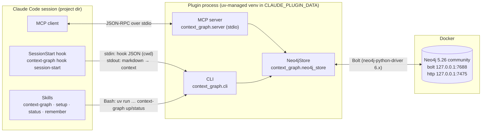

# Context Graph — persistent graph memory for Claude Code

[](LICENSE)


`context-graph` is a Claude Code plugin that gives Claude a long-term memory. The memory is a
property graph stored in Neo4j.

When the plugin is enabled in a project, Claude reads and writes typed nodes through an MCP
server. Nodes cover the user, preferences, decisions, concepts, resources, tasks and sessions,
linked by typed relationships. The data lives in a single shared graph. Each node is scoped to the
project it came from, while knowledge about the user is global and follows them into every
project. A `SessionStart` hook injects a compact overview into Claude's context, so every session
starts with what earlier sessions learned.

This repository is two things at once:
- a **Claude Code plugin marketplace**: `.claude-plugin/marketplace.json`
- the **plugin** itself: `plugins/context-graph/`

---

## Table of contents

1. [Architecture](#1-architecture)
2. [Requirements](#2-requirements)
3. [Installation and setup](#3-installation-and-setup)
4. [Runtime lifecycle](#4-runtime-lifecycle)
5. [Graph data model](#5-graph-data-model)
6. [MCP tool reference](#6-mcp-tool-reference)
7. [Query semantics](#7-query-semantics)
8. [Configuration reference](#8-configuration-reference)
9. [Local database (Docker)](#9-local-database-docker)
10. [CLI reference](#10-cli-reference)
11. [Backup, restore and migration](#11-backup-restore-and-migration)
12. [Security model](#12-security-model)
13. [Troubleshooting](#13-troubleshooting)
14. [Development](#14-development)
15. [Repository layout](#15-repository-layout)
16. [Uninstall](#16-uninstall)
17. [License](#17-license)

---

## 1. Architecture



| Layer | Module | Responsibility |
|---|---|---|
| Model | `model.py` | dataclasses `Node` and `Relation`; validation of ids, types, relations and statuses; conversion to Cypher-safe identifiers; path normalization; legacy markdown parser |
| Config | `config.py` | resolves connection settings from env and userConfig; generates and reads the local password file; resolves the project directory |
| Store | `neo4j_store.py` | all Cypher: schema, CRUD, scoping, full-text search, read-only queries, export/import |
| Render | `render.py` | markdown views (node page, overview, project context) shared by the server and the hook |
| Server | `server.py` | MCP server (`mcp` SDK 2.x `MCPServer`, stdio) exposing 11 tools plus server instructions |
| CLI | `cli.py` | `up` / `down` / `status` / `hook` / `overview` / `show` / `search` / `export` / `import` / `import-markdown` / `init-schema` |

Design choices:
- **Stateless processes.** The MCP server and the hook hold no state between calls apart from a
  `project_dir → project_id` cache. All state lives in Neo4j.
- **Fail-open hook.** If Neo4j is unreachable, the hook prints a one-line notice and exits `0`. A
  missing database never blocks a session.
- **Atomic writes.** `upsert_node` writes the node, its relations and its project link in a single
  managed write transaction (`session.execute_write`). If a relation target is missing, the whole
  upsert is rolled back.
- **Schema-free properties, strict identifiers.** Labels and relationship types can't be
  parameterized in Cypher, so they are validated against strict regexes before they are
  interpolated (see [§12](#12-security-model)).

---

## 2. Requirements

| Component | Version | Why |
|---|---|---|
| Claude Code | recent 2.x with plugin support (`claude plugin …`) | loads the plugin, MCP server, hook and skills |
| Docker Engine / Docker Desktop | Compose v2 (`docker compose`) | runs the bundled Neo4j. Not needed with an external Neo4j |
| [uv](https://docs.astral.sh/uv/) | ≥ 0.4 | creates the Python environment and runs the server and CLI. Downloads a Python ≥ 3.11 automatically if none is present |
| Network | outbound HTTPS on first run | PyPI packages and the `neo4j:5.26-community` image (~600 MB) |
| RAM | ~1.5 GB free for the container | heap max 1 GB plus 512 MB page cache (tunable in `docker/compose.yml`) |

Platforms: developed and verified on **Windows 11** (Git Bash runs the hooks). macOS and Linux
are expected to work, since everything is POSIX shell plus Python, but haven't been verified yet.

`uv` and `docker` must be on the `PATH` of the process that launches Claude Code. If Claude Code
is started from an IDE or a desktop shortcut, make sure that environment inherits your shell's
`PATH`.

---

## 3. Installation and setup

### 3.1 Install the plugin

**From GitHub.** The marketplace is named `context-graph`:

```sh
claude plugin marketplace add matinebdi/context-graph-claude
```

Then, in each project that should have graph memory:

```sh
cd /path/to/your/project
claude plugin install context-graph@context-graph --scope project
```

Inside Claude Code you can do both steps at once:

```
/plugin install context-graph --marketplace matinebdi/context-graph-claude
```

The `--scope` flag decides where the plugin is enabled:

| `--scope` | Written to | Effect |
|---|---|---|
| `project` | `<project>/.claude/settings.json` | enabled for this project, and for collaborators if the file is committed |
| `local` | `<project>/.claude/settings.local.json` | enabled for this project, for you only |
| `user` | `~/.claude/settings.json` | enabled in every project |

**From a local clone** (for development):

```sh
git clone https://github.com/matinebdi/context-graph-claude.git
claude plugin marketplace add ./context-graph-claude
```

A directory marketplace is read in place, so edits apply after `/reload-plugins` or a restart.

### 3.2 Plugin options (userConfig)

When the plugin is enabled, Claude Code may prompt for four options. **For the bundled local
database, accept the defaults and leave the password empty.** See
[§8](#8-configuration-reference) for the full table. The options can be changed later with
`/plugin configure context-graph@context-graph` or in `/config`.

### 3.3 Start the database (once per machine)

Inside Claude Code:

```
/context-graph:setup
```

The command does the following:
1. Checks that `docker info` and `uv --version` succeed.
2. Runs `context-graph up`, which:
   1. Generates a 192-bit random password (`secrets.token_urlsafe(24)`) into
      `~/.context-graph/neo4j-password`, with mode `0600` where supported, if the file doesn't
      exist yet.
   2. Runs `docker compose -f <plugin>/docker/compose.yml up -d`, with
      `CONTEXT_GRAPH_NEO4J_PASSWORD` exported to Compose.
   3. Polls `verify_connectivity()` every 3 seconds, for up to 180 seconds.
   4. Applies the schema (constraints and indexes, all `IF NOT EXISTS`, so it is idempotent).
3. Runs `context-graph status`.

The equivalent manual commands, from a clone, are:

```sh
cd plugins/context-graph
uv run context-graph up
uv run context-graph status
```

### 3.4 Verify

```
/context-graph:status
```

Expected output:

```
Neo4j: bolt://127.0.0.1:7688  database=neo4j  user=neo4j
Status: online, N nodes
Project for /path/to/your/project: <project-id>
```

Start a new session. Its context should begin with `# Context graph: …` (injected by the hook),
and `/mcp` should list the server `plugin:context-graph:context-graph` as connected.

To browse the graph, open **http://127.0.0.1:7475** and connect with:
- URL: `bolt://127.0.0.1:7688`
- user: `neo4j`
- password: the contents of `~/.context-graph/neo4j-password`

---

## 4. Runtime lifecycle

### 4.1 Session start (hook)

`hooks/hooks.json` registers a `SessionStart` command hook with matcher
`startup|resume|clear|compact` and a 120-second timeout:

```sh
UV_PROJECT_ENVIRONMENT="${CLAUDE_PLUGIN_DATA}/venv" \
  uv run --quiet --frozen --project "${CLAUDE_PLUGIN_ROOT}" context-graph hook session-start
```

Each hook run goes through these steps:
1. `uv` syncs the locked environment into `${CLAUDE_PLUGIN_DATA}/venv`.
   - The first run installs the dependencies, which takes seconds to a minute.
   - Later runs reuse the environment.
   - `--frozen` stops `uv` from rewriting `uv.lock` inside the (read-only) plugin cache.
2. The hook reads the hook JSON from stdin. The project directory comes from
   `CLAUDE_PROJECT_DIR`, then the hook's `cwd`, then `os.getcwd()`.
3. It calls `ping()`, then `ensure_project(dir)`, which finds the `:Project` whose `path_key` is
   the longest prefix of the directory. If there is none, it creates one, with
   `id = slugify(basename)` and suffixes `-2`, `-3`, … on collision.
4. It prints markdown to stdout. Claude Code adds `SessionStart` stdout to the model context. The
   output contains:
   - **Graph overview:** counts by type, people, preferences, projects, the current project's open
     tasks, decisions and last 3 sessions, and recently updated nodes.
   - **Project page:** the current project's node with its relations and members.
   - **Usage footer:** a reminder of how to use the graph.
5. On any `GraphError` it prints
   `[context-graph] The context graph is offline (…)` and exits `0`.

### 4.2 MCP server

`.mcp.json` starts the server over stdio:

```json
{
  "command": "uv",
  "args": ["run", "--quiet", "--frozen", "--project", "${CLAUDE_PLUGIN_ROOT}", "context-graph-mcp"],
  "env": {
    "UV_PROJECT_ENVIRONMENT": "${CLAUDE_PLUGIN_DATA}/venv",
    "CONTEXT_GRAPH_NEO4J_URI": "${user_config.neo4j_uri}",
    "CONTEXT_GRAPH_NEO4J_USER": "${user_config.neo4j_user}",
    "CONTEXT_GRAPH_NEO4J_PASSWORD": "${user_config.neo4j_password}",
    "CONTEXT_GRAPH_NEO4J_DATABASE": "${user_config.neo4j_database}"
  }
}
```

How the server behaves:
- **Working directory.** `--project` is used instead of `--directory` so the server's working
  directory stays the session's project directory. `CLAUDE_PROJECT_DIR` is preferred when it is
  set.
- **Lazy driver.** The Neo4j driver is created on the first tool call. If no password was
  available at startup, the settings are re-read from env and the password file on every
  connection attempt. So running `/context-graph:setup` mid-session fixes the server without a
  restart.
- **Driver configuration:**
  - `connection_timeout=5s`
  - `connection_acquisition_timeout=10s`
  - `max_transaction_retry_time=5s`
  - `notifications_min_severity="OFF"`, because in a schema-free graph the
    "unknown property / relationship type" notices are noise
- **Errors.** Every tool catches `GraphError` and returns `Error: …` as text, so Claude sees a
  readable failure instead of a protocol error.

### 4.3 Skills

| Skill | Invocation | Purpose |
|---|---|---|
| `context-graph` | model-invoked (auto) | policy: when to recall, what to record, dedupe and supersede rules, no secrets |
| `setup` | `/context-graph:setup` (user only) | prerequisites check, `context-graph up`, status |
| `status` | `/context-graph:status` (user only) | connectivity, counts, project mapping |
| `remember` | `/context-graph:remember <text>` (user only) | classify the text, search, then upsert |

The skills call the CLI through `${CLAUDE_PLUGIN_ROOT}` / `${CLAUDE_PLUGIN_DATA}`. Claude Code
substitutes these into the skill body. They are **not** present in the Bash tool's environment.

---

## 5. Graph data model

### 5.1 Nodes

Every node carries the label `:Entity` plus exactly one type label. The type label is the
PascalCase form of `type`: `decision` becomes `:Decision`, and `user_story` becomes
`:UserStory`.

| Property | Type | Notes |
|---|---|---|
| `id` | string | **unique** (constraint). Must match `^[a-z0-9][a-z0-9-]{0,79}$` |
| `type` | string | `^[a-z][a-z0-9_]{0,39}$`. Mirrors the type label |
| `title` | string | human-readable name |
| `summary` | string | one line, shown in every listing |
| `body` | string | markdown; `append_body` adds `**YYYY-MM-DD:** …` paragraphs |
| `status` | string | `active` · `done` · `superseded` · `archived` |
| `tags` | list\<string\> | lower-cased, de-duplicated, sorted |
| `tags_text` | string | space-joined `tags`, because full-text indexes only cover strings |
| `path` | string? | filesystem root (projects) |
| `path_key` | string? | `normalize_path(path)`: forward slashes, case-folded on Windows, Git Bash `/c/…` mapped to `c:/…`. Used for prefix matching |
| `created`, `updated` | string | UTC ISO-8601, `YYYY-MM-DDTHH:MM:SSZ`, so they sort lexicographically |

The default ontology is extensible: any snake_case `type` is accepted.

| `type` | Default scope | Used for |
|---|---|---|
| `person` | global | the user and people they work with |
| `preference` | global | how the user wants things done; the overview lists these as rules to follow |
| `tool` | global | software, services, libraries |
| `project` | global | a codebase or effort; matched to directories via `path` |
| `decision` | project | a choice that was made, with its rationale |
| `concept` | project | domain knowledge, architecture, components |
| `resource` | project | URLs, docs, dashboards, tickets |
| `task` | project | open work that spans sessions |
| `session` | project | log of one working session (`log_session`) |
| *custom* | project | anything else |

### 5.2 Relationships

- **User relationships** are real Neo4j relationship types, written in upper snake case. They are
  accepted case-insensitively (`works_on` is stored as `WORKS_ON`) and must match
  `^[A-Za-z][A-Za-z0-9_]{0,39}$`. Each one has an optional `note` property.
- **Suggested vocabulary:** `WORKS_ON`, `OWNS`, `PREFERS`, `DECIDED`, `PART_OF`, `DEPENDS_ON`,
  `USES`, `RELATES_TO`, `SUPERSEDES`, `ABOUT`, `DOCUMENTED_IN`, `BLOCKS`, `FOLLOWS_UP`.
- **System relationship:** `IN_PROJECT`, written `(n)-[:IN_PROJECT]->(:Project)`, is reserved for
  scoping. `link()` rejects it; use `scope` or `set_node_project` instead. It is excluded from
  `relations` and neighbor listings.

Relations are directed and de-duplicated with `MERGE` on `(source, TYPE, target)`. Re-linking only
updates `note` when a new note is given.

### 5.3 Scoping rules

`upsert_node(scope=…)` decides whether a node gets an `IN_PROJECT` link:

| `scope` | Behavior |
|---|---|
| `auto` (default) | link to the current project unless the node's type (given or existing) is in `{person, preference, tool, project}` |
| `project` | always link to the current project |
| `global` | never add a link (existing links are kept; remove them with `set_node_project(remove=True)`) |

A node can belong to several projects. "Global" means the node has no `IN_PROJECT` edge.

### 5.4 Schema

`init_schema()` applies these statements. It runs on `up` and with `context-graph init-schema`:

```cypher
CREATE CONSTRAINT entity_id IF NOT EXISTS FOR (n:Entity) REQUIRE n.id IS UNIQUE;
CREATE INDEX entity_type    IF NOT EXISTS FOR (n:Entity)  ON (n.type);
CREATE INDEX entity_updated IF NOT EXISTS FOR (n:Entity)  ON (n.updated);
CREATE INDEX project_path   IF NOT EXISTS FOR (n:Project) ON (n.path_key);
CREATE FULLTEXT INDEX entity_text IF NOT EXISTS
  FOR (n:Entity) ON EACH [n.id, n.title, n.summary, n.body, n.tags_text];
```

### 5.5 Example

```cypher
(:Entity:Person    {id:'alice'})-[:WORKS_ON]->(:Entity:Project {id:'shop-api', path:'/home/alice/shop-api'})
(:Entity:Person    {id:'alice'})-[:PREFERS]->(:Entity:Preference {id:'pref-small-commits'})
(:Entity:Decision  {id:'decision-use-postgres', status:'active'})-[:PART_OF]->(:Project {id:'shop-api'})
(:Entity:Decision  {id:'decision-use-postgres'})-[:SUPERSEDES]->(:Decision {id:'decision-use-sqlite', status:'superseded'})
(:Entity:Decision  {id:'decision-use-postgres'})-[:IN_PROJECT]->(:Project {id:'shop-api'})
```

---

## 6. MCP tool reference

Server name: `context-graph`. In Claude Code, `/mcp` lists it as `plugin:context-graph:context-graph`,
and the tool names carry that plugin and server prefix. Every tool returns markdown or JSON text.
Failures come back as `Error: <reason>`.

| Tool | Parameters | Semantics |
|---|---|---|
| `graph_overview` | `all_projects: bool = false` | overview scoped to the current project (plus global nodes), or the whole graph |
| `search_graph` | `query: str`, `type?: str`, `limit = 10` | full-text search ([§7.1](#71-full-text-search)) |
| `get_node` | `id: str`, `depth: 1\|2 = 1` | properties, body, outgoing and incoming relations, project members for `:Project`; `depth=2` adds second-degree neighbors (max 40) |
| `context_for_directory` | `path: str` | project node(s) whose `path` contains `path`, most specific first (max 2) |
| `upsert_node` | `id`, `type?`, `title?`, `summary?`, `body?`, `append_body?`, `tags?: [str]`, `relations?: [{type, target, note?}]`, `path?`, `status?`, `scope = "auto"` | create (needs `type`) or merge. Only the fields you pass change. `tags` replaces the existing tags; `relations` adds to the existing ones. Atomic |
| `link` | `source`, `relation`, `target`, `note?` | `MERGE` a relationship. Both endpoints must exist |
| `unlink` | `source`, `relation`, `target` | delete that relationship |
| `set_node_project` | `id`, `project?` (default current), `remove = false` | add or remove `IN_PROJECT` |
| `delete_node` | `id` | `DETACH DELETE`. Returns the count of incoming relations removed. Prefer `status: archived` or `superseded` for anything with history |
| `log_session` | `summary`, `details?`, `related?: [id]` | creates `session-YYYY-MM-DD-<project>[-n]`, linked `ABOUT` the project, `RELATES_TO` each related id, and `IN_PROJECT` |
| `query_cypher` | `cypher`, `params?: object` | arbitrary Cypher in a **read** transaction. Returns up to 100 rows as JSON |

Server instructions sent at initialization describe the read and write policy, the scope rules,
the default types and the relation vocabulary, so any MCP client gets the same guidance as the
skill.

---

## 7. Query semantics

### 7.1 Full-text search

1. **Build the Lucene query.** The input is tokenized with `\w+` and lower-cased, so every Lucene
   operator and special character is dropped. Each token `t` becomes `t OR t*` (exact match or
   prefix match): `"rotate jwt"` becomes `rotate OR rotate* OR jwt OR jwt*`.
2. **Query the index.** `db.index.fulltext.queryNodes('entity_text', $q)` runs over id, title,
   summary, body and tags.
3. **Re-score:**
   - multiply by `1.5` if the node is `IN_PROJECT` the current project
   - multiply by `0.5` if `status <> 'active'`
4. **Return.** Results are optionally filtered by `type`, ordered by score then id, and cut off
   at `limit`.

### 7.2 Overview selection

| Section | Filter |
|---|---|
| People, Preferences | `status='active'` and (in the current project or global); up to 25 each |
| Projects | all active projects, most recently updated first; up to 10 |
| Open tasks / Decisions in *project* | `IN_PROJECT` the current project, `status='active'`; up to 15 each |
| Recent sessions in *project* | the last 3 sessions, any status |
| Recently updated | the last 8 nodes graph-wide |

### 7.3 Read-only Cypher

`query_cypher` opens a session with `default_access_mode=READ_ACCESS` and runs the query inside
`execute_read`. The Neo4j server rejects any write in that transaction, for example with
`Writing in read access mode not allowed`. Results are fetched with `Result.fetch(100)` and
converted to JSON. Temporal and spatial values are converted with `str()`.

Useful queries:

```cypher
// open tasks across all projects
MATCH (t:Task {status:'active'})-[:IN_PROJECT]->(p:Project) RETURN p.id, t.id, t.title ORDER BY p.id;

// decision history chains
MATCH path = (d:Decision)-[:SUPERSEDES*]->(old:Decision) RETURN [n IN nodes(path) | n.id] AS chain;

// orphan nodes (no relations at all)
MATCH (n:Entity) WHERE NOT (n)--() RETURN n.id, n.type;

// what depends on a component
MATCH (x:Entity)-[:DEPENDS_ON*1..3]->(c:Entity {id:$id}) RETURN DISTINCT x.id, x.type;
```

---

## 8. Configuration reference

### 8.1 Plugin options (`userConfig`)

| Key | Type | Default | Notes |
|---|---|---|---|
| `neo4j_uri` | string | `bolt://127.0.0.1:7688` | any Bolt URI: `bolt://`, `neo4j://`, `neo4j+s://` (Aura) |
| `neo4j_user` | string | `neo4j` | |
| `neo4j_password` | string, **sensitive** | *(empty)* | stored in the OS secure credential store, not in `settings.json`. Leave empty for the local DB |
| `neo4j_database` | string | `neo4j` | Community Edition has a single user database, `neo4j` |

### 8.2 Resolution order

For each setting, `config.Settings.from_env()` takes the first non-empty value that isn't a
literal `${…}` placeholder:

1. `CONTEXT_GRAPH_NEO4J_{URI,USER,PASSWORD,DATABASE}`: set by `.mcp.json` from userConfig, or by
   you.
2. `CLAUDE_PLUGIN_OPTION_NEO4J_{URI,USER,PASSWORD,DATABASE}`: exported by Claude Code to plugin
   hooks.
3. For the password only, the contents of `$CONTEXT_GRAPH_HOME/neo4j-password`.
4. The defaults in the table above.

The `${…}` check matters because an unset userConfig option can reach the process as a literal
string such as `${user_config.neo4j_password}`.

### 8.3 Environment variables

| Variable | Default | Used by | Effect |
|---|---|---|---|
| `CONTEXT_GRAPH_HOME` | `~/.context-graph` | all | location of `neo4j-password` |
| `CONTEXT_GRAPH_BOLT_PORT` | `7688` | `up`, Compose | host bolt port; also the advertised address. Update `neo4j_uri` to match |
| `CONTEXT_GRAPH_HTTP_PORT` | `7475` | `up`, Compose | host port for Neo4j Browser / HTTP API |
| `CLAUDE_PROJECT_DIR` | *(set by Claude Code)* | server, hook | project directory used for scoping |
| `UV_PROJECT_ENVIRONMENT` | `${CLAUDE_PLUGIN_DATA}/venv` | hook, server, skills | location of the plugin venv; it survives plugin updates |
| `CONTEXT_GRAPH_TEST_URI` / `CONTEXT_GRAPH_TEST_PASSWORD` | — | tests | use an existing **disposable** database instead of a throwaway container. Tests wipe it |

---

## 9. Local database (Docker)

`plugins/context-graph/docker/compose.yml` (Compose project `context-graph`):

| Setting | Value | Reason |
|---|---|---|
| image | `neo4j:5.26-community` | 5.26 LTS line |
| container | `context-graph-neo4j` | fixed name for `docker logs` / `exec` |
| ports | `127.0.0.1:7475→7474`, `127.0.0.1:7688→7687` | loopback only. Non-default host ports avoid clashing with an existing Neo4j on 7474/7687 |
| `NEO4J_server_bolt_advertised__address` | `127.0.0.1:${CONTEXT_GRAPH_BOLT_PORT:-7688}` | the discovery endpoint and routing table advertise the host-side port. Without it, clients such as Neo4j Browser and `neo4j://` routing are told `localhost:7687` |
| `NEO4J_AUTH` | `neo4j/${CONTEXT_GRAPH_NEO4J_PASSWORD}` | Compose fails fast (`:?`) if the variable isn't set |
| memory | heap 512 MB → 1 GB, page cache 512 MB | sized for a personal graph |
| restart | `unless-stopped` | comes back with Docker |
| volume | `context-graph_neo4j-data:/data` | persistent store |

> `NEO4J_AUTH` only takes effect when the volume is **first initialized**. Changing or losing the
> password file later doesn't change the database password. See
> [§13](#13-troubleshooting).

`127.0.0.1` is used instead of `localhost` throughout because the ports are published on IPv4
only, and on Windows `localhost` may resolve to `::1` first.

Manual container operations:

```sh
docker logs -f context-graph-neo4j
docker exec -it context-graph-neo4j cypher-shell -u neo4j -p "$(cat ~/.context-graph/neo4j-password)"
uv run --project plugins/context-graph context-graph down    # stop, keep data
```

---

## 10. CLI reference

Run the CLI from `plugins/context-graph/` with `uv run context-graph <cmd>`. From any directory,
use `uv run --project <path-to>/plugins/context-graph context-graph <cmd>`.

| Command | Description |
|---|---|
| `up` | create the password if missing, `docker compose up -d`, wait for Bolt, apply the schema |
| `down` | `docker compose stop` (the data volume is kept) |
| `status [--dir D]` | URI, connectivity, node counts by type, project mapped to `D` (default: project dir / cwd) |
| `init-schema` | apply constraints and indexes (idempotent) |
| `hook session-start` | the SessionStart hook entry point (reads hook JSON on stdin) |
| `overview [--all]` | the overview the hook injects; registers the cwd as a project if needed |
| `show <id> [--depth 1\|2]` | node page |
| `search <query> [--type T]` | full-text search |
| `export <file.json>` | dump every node with its relations and projects |
| `import <file.json>` | load an export in one transaction (upsert semantics; timestamps preserved) |
| `import-markdown <dir>` | import the legacy one-file-per-node markdown format (YAML frontmatter + body) |

Exit codes: `0` on success, and `1` on `GraphError` or a failed `docker compose`. The
`hook` command always exits `0`.

---

## 11. Backup, restore and migration

```sh
uv run context-graph export ~/context-graph-backup.json
uv run context-graph import ~/context-graph-backup.json
```

The export format is:

```json
{ "format": "context-graph", "version": 1,
  "nodes": [ { "id": "…", "type": "…", "title": "…", "summary": "…", "body": "…",
               "status": "active", "path": null, "tags": [],
               "relations": [ { "type": "PART_OF", "target": "…", "note": "…" } ],
               "projects": [ "…" ], "created": "…", "updated": "…" } ] }
```

How an import behaves:
- The whole import runs in a single write transaction. If any relation target is missing, the
  entire import is aborted.
- It upserts: existing nodes are overwritten, nothing is deleted, and timestamps are preserved.

To move to another Neo4j, such as Aura or a team server: export, change the `neo4j_*` options,
run `context-graph init-schema`, then import.

For an on-disk backup of the local DB, use `neo4j-admin database dump` inside the container while
the database is stopped, or snapshot the `context-graph_neo4j-data` volume.

---

## 12. Security model

| Concern | Mitigation |
|---|---|
| Network exposure | ports bound to `127.0.0.1` only. Nothing listens on external interfaces |
| Credentials | random per-machine password in `~/.context-graph/neo4j-password` (mode 0600 on POSIX). External DB passwords go in the OS credential store (`sensitive: true`). No credential is written to the repo or `settings.json` |
| Cypher injection | values are always passed as parameters. Labels and relationship types, which can't be parameterized, are interpolated only after `to_label` / `to_rel` validation against `^[a-z][a-z0-9_]{0,39}$` / `^[A-Za-z][A-Za-z0-9_]{0,39}$`. Node ids are validated against `^[a-z0-9][a-z0-9-]{0,79}$` |
| Destructive queries from the model | `query_cypher` runs in a READ transaction, so the server rejects writes. Deletion is only possible node by node through `delete_node` |
| Sensitive data in memory | the `context-graph` skill and the server instructions tell Claude never to store secrets, tokens, passwords, or personal data the user didn't choose to share |
| Search query parsing | Lucene operators are stripped by tokenization before the full-text query runs |

The graph is **personal and local by default**. If you point several users at one shared Neo4j,
every user can read and write every node. There is no per-user access control in the plugin.

---

## 13. Troubleshooting

| Symptom | Cause | Fix |
|---|---|---|
| Session starts with `[context-graph] The context graph is offline (…)` | Docker or the container isn't running, or there is no password yet | `/context-graph:setup`, or `docker start context-graph-neo4j` |
| `Bind for 0.0.0.0:7475/7688 failed: port is already allocated` | another service holds the port | `CONTEXT_GRAPH_BOLT_PORT=7690 CONTEXT_GRAPH_HTTP_PORT=7476 uv run context-graph up`, then set `neo4j_uri` to `bolt://127.0.0.1:7690` |
| `Neo4j rejected the credentials` after reinstalling | the volume was created with a previous password; `NEO4J_AUTH` is ignored after the first init | restore the old `~/.context-graph/neo4j-password`, **or** (this destroys the graph) `docker compose -p context-graph down -v` and run `up` again |
| Neo4j Browser: *Could not perform discovery. No routing servers available* | Browser is connecting to `:7687` (a stale saved connection) or through `localhost` → `::1` | open `http://127.0.0.1:7475/browser/?connectURL=bolt://neo4j@127.0.0.1:7688`, or clear the site data for that origin |
| First session hangs for a while | `uv` is installing dependencies into `${CLAUDE_PLUGIN_DATA}/venv` | wait once; the hook timeout is 120 s. Pre-warm with `/context-graph:status` |
| `uv: command not found` in hook or MCP logs | `uv` isn't on the `PATH` of the Claude Code process | install uv, then restart Claude Code from a shell that has it on `PATH` |
| MCP tools return `Error: no Neo4j password configured` | setup never ran on this machine | `/context-graph:setup`; the next tool call reconnects automatically |
| `/mcp` shows the server as failed | `uv` sync error, offline PyPI, or Python download blocked | run `uv run --frozen --project <plugin-root> context-graph-mcp` manually to see stderr |

Logs: hook stdout and stderr appear in Claude Code's debug output (`claude --debug`). MCP server
stderr goes to the MCP logs. Neo4j logs: `docker logs context-graph-neo4j`.

---

## 14. Development

```sh
git clone https://github.com/matinebdi/context-graph-claude.git
cd context-graph-claude/plugins/context-graph
uv sync                           # creates .venv with dev deps (pytest)
uv run pytest -q                  # unit + integration
claude plugin validate .          # manifest, hooks, MCP config
claude plugin validate ../..      # marketplace
```

The test suite has two parts:
- **`tests/test_model.py`** holds pure unit tests:
  - validation and identifier safety, including injection attempts against `to_rel`
  - path normalization
  - Lucene query building
  - the legacy parser
  - config resolution with unresolved placeholders
- **`tests/test_neo4j_store.py`** holds integration tests against a **throwaway** container:
  - The container is `context-graph-test-neo4j` on `127.0.0.1:17687`, created and removed by a
    session fixture. They are skipped when Docker is unavailable, and never touch your real
    database.
  - They cover:
    - upsert, merge and label changes
    - transactional rollback
    - link deduplication
    - delete cascade
    - project scoping and include-global semantics
    - full-text and prefix search with project boosting
    - read-only enforcement
    - export/import round-trip with timestamp preservation
    - rendering

For iterating on the plugin live, add the clone as a directory marketplace (§3.1), edit, then run
`/reload-plugins`. To test the MCP server without Claude Code, use any MCP stdio client. For
example, with the Python SDK:

```python
StdioServerParameters(command="uv",
    args=["run", "--frozen", "--project", "plugins/context-graph", "context-graph-mcp"],
    env={**os.environ, "CLAUDE_PROJECT_DIR": "/some/project"})
```

Releasing: bump `version` in both `plugins/context-graph/.claude-plugin/plugin.json` and
`pyproject.toml`. Claude Code pins installs to the manifest version, so users only get updates
when it changes. If you change dependencies, run `uv lock`, since `--frozen` installs exactly
what's in `uv.lock`.

---

## 15. Repository layout

```
.
├── .claude-plugin/
│   └── marketplace.json              # marketplace "context-graph" → ./plugins/context-graph
├── .claude/settings.json             # enables the plugin for this repo (dogfooding)
├── LICENSE                           # MIT
├── README.md
└── plugins/context-graph/            # ← ${CLAUDE_PLUGIN_ROOT}
    ├── .claude-plugin/plugin.json    # manifest + userConfig
    ├── .mcp.json                     # stdio MCP server via uv
    ├── hooks/hooks.json              # SessionStart → context-graph hook session-start
    ├── skills/
    │   ├── context-graph/SKILL.md    # usage policy (model-invoked)
    │   ├── setup/SKILL.md            # /context-graph:setup
    │   ├── status/SKILL.md           # /context-graph:status
    │   └── remember/SKILL.md         # /context-graph:remember
    ├── docker/compose.yml            # local Neo4j
    ├── pyproject.toml · uv.lock      # package "context-graph"; entry points context-graph, context-graph-mcp
    ├── src/context_graph/
    │   ├── model.py  config.py  neo4j_store.py  render.py  server.py  cli.py
    └── tests/
        ├── test_model.py
        └── test_neo4j_store.py
```

---

## 16. Uninstall

```sh
claude plugin uninstall context-graph@context-graph              # add --keep-data to keep the venv in CLAUDE_PLUGIN_DATA
uv run --project <plugin-root> context-graph down                # stop the container
docker rm context-graph-neo4j                                    # remove the container
docker volume rm context-graph_neo4j-data                        # DELETES THE GRAPH. Export first (§11)
rm -r ~/.context-graph                                           # password file
claude plugin marketplace remove context-graph
```

---

## 17. License

[MIT](LICENSE) © 2026 Matin Ebadi
