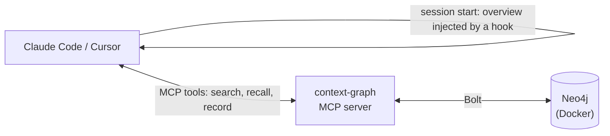

# Context Graph

**Long-term memory for AI coding agents, stored as a knowledge graph.**

[](LICENSE)


Coding agents forget everything between sessions. Context Graph gives them a memory: a Neo4j graph
the agent reads at the start of every session and writes to as it works. It holds who you are, how
you like to work, what was decided and why, how the project fits together, and what is still open.

- **Works with Claude Code and Cursor**, and with any other MCP client. All of them share one
  graph.
- **Scoped per project, personal everywhere.** Decisions and tasks stay with their project, while
  your preferences follow you into every project.
- **Finds things by meaning, in any language.** Search is hybrid (keywords + local embeddings),
  so a French question finds an English note. Nothing leaves your machine.
- **Doesn't let knowledge slip away.** After substantial work, the agent is reminded once to
  record what it learned. It is also warned about duplicates, and can review and tidy the graph.
- **A real graph.** You can browse it in Neo4j Browser and query it with Cypher.
- **Local and private by default.** Neo4j runs in Docker, reachable only from `127.0.0.1`.

## How it works



1. When a session starts, a hook loads a compact overview into the agent's context: your
   preferences, plus the current project's open tasks and key decisions, ranked by importance.
2. While the agent works, it calls MCP tools to search the graph, read nodes, and record
   decisions, preferences, concepts and tasks.
3. A rule (a Claude skill, or a Cursor rule) tells the agent when to recall and what is worth
   recording.
4. When a turn ends after substantial unrecorded work, a hook reminds the agent once to save
   what it learned.

## Quick start

You need **Docker**, **[uv](https://docs.astral.sh/uv/getting-started/installation/)**, and
**Claude Code or Cursor**.

### Claude Code

```sh
claude plugin marketplace add matinebdi/context-graph
cd your-project
claude plugin install context-graph@context-graph --scope project
```

Then run `/context-graph:setup` inside Claude Code. You only need to do this once per machine.

### Cursor

```sh
uv tool install "git+https://github.com/matinebdi/context-graph#subdirectory=plugins/context-graph"
context-graph up                  # once per machine: starts Neo4j in Docker
cd your-project
context-graph install cursor      # then restart Cursor
```

### Check that it works

Start a new session. It should open with `# Context graph: …`. You can also run
`/context-graph:status` in Claude Code, or `context-graph status` in a terminal.

To see the graph, open **http://127.0.0.1:7475** and connect to `bolt://127.0.0.1:7688` as user
`neo4j`. The password is in `~/.context-graph/neo4j-password`.

> **No Docker?** Use a free Neo4j Aura instance instead. See
> [Installation → External Neo4j](docs/installation.md#external-neo4j-no-docker).

## What it remembers

| Type | Scope | Example |
|---|---|---|
| `person` | everywhere | you, your role, your teammates |
| `preference` | everywhere | "small commits", "concise answers" |
| `tool` | everywhere | the libraries and services you use |
| `project` | everywhere | each codebase, matched to its folder |
| `decision` | its project | "use Postgres, because…" |
| `concept` | its project | how the auth flow works |
| `resource` | its project | the dashboard URL, the design doc |
| `task` | its project | work left open between sessions |
| `session` | its project | a log of what a session did |

Nodes are linked by typed relationships such as `DECIDED`, `DEPENDS_ON`, `PART_OF` and
`SUPERSEDES`. When a decision changes, the old one is marked superseded instead of being
overwritten, so the history stays. See [Data model](docs/data-model.md).

## Everyday use

Most of it happens automatically: the agent recalls and records as it works. You can also steer
it:

| | Claude Code | Cursor / terminal |
|---|---|---|
| Store something explicitly | `/context-graph:remember <text>` | ask the agent to remember it |
| Check the connection | `/context-graph:status` | `context-graph status` |
| Search the graph | ask the agent | `context-graph search "<words>"` |
| Tidy up (duplicates, orphans, stale tasks) | ask the agent to review the graph | `context-graph review` |
| Back up the graph | | `context-graph export backup.json` |

## Documentation

| Guide | Covers |
|---|---|
| [Installation](docs/installation.md) | requirements, install options for each client, external Neo4j, verifying the install |
| [Architecture](docs/architecture.md) | components, packages, the session lifecycle, design choices |
| [Data model](docs/data-model.md) | nodes, relationships, project scoping, schema, search and overview rules |
| [Reference](docs/reference.md) | MCP tools, CLI commands, configuration and environment variables |
| [Operations](docs/operations.md) | the local database, backup and migration, security, uninstalling |
| [Troubleshooting](docs/troubleshooting.md) | known problems and their fixes |
| [Development](docs/development.md) | dev setup, tests, repository layout, releasing |

## License

[MIT](LICENSE) © 2026 Matin Ebadi
