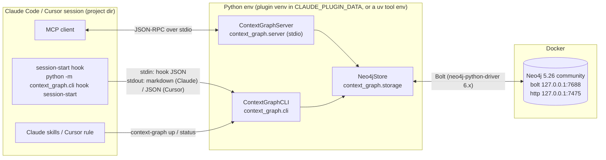

# Architecture

[← README](../README.md)

- [Overview](#overview)
- [Packages](#packages)
- [Design choices](#design-choices)
- [Session start (hook)](#session-start-hook)
- [End of work (stop hook)](#end-of-work-stop-hook)
- [MCP server](#mcp-server)
- [Usage rules: skills and Cursor rule](#usage-rules-skills-and-cursor-rule)

## Overview



This repository is four things at once:
- **two plugin marketplaces**: `.claude-plugin/marketplace.json` (Claude Code) and
  `.cursor-plugin/marketplace.json` (Cursor), both pointing at `plugins/context-graph/`
- the **Claude Code plugin**: `.claude-plugin/plugin.json`, `.mcp.json`, `hooks/`, `skills/`
- the **Cursor plugin**, in the same folder: `.cursor-plugin/plugin.json`, `mcp.json` and
  `cursor/` (rules, commands, hooks). Its manifest sets every component path explicitly, so the
  two clients never load each other's files: the Claude files use `${CLAUDE_PLUGIN_DATA}`, which
  Cursor doesn't expand.
- the **Python package** `context-graph`, also in that folder, which provides the MCP server and
  the CLI, including the installer for clients without plugin support

## Packages

| Package | Classes | Responsibility |
|---|---|---|
| `domain/` | `Node`, `Relation`, `Schema`, `Clock`, `PathKey`, `GraphError` | entities; validation of ids, types and statuses; Cypher-safe labels and relationship types; path normalization; legacy markdown parser |
| `config/` | `Environment`, `LocalCredentials`, `Settings` | env and userConfig (ignoring unresolved `${…}` placeholders); the local password; the project directory |
| `semantic/` | `Embedder` | local multilingual embeddings (fastembed / ONNX); lazy, and degrades to "unavailable" instead of failing |
| `storage/` | `Neo4jStore`, `GraphMaintenance`, `Ranking`, `Neo4jErrorTranslator` | all Cypher: schema, CRUD, scoping, hybrid search, read-only queries, export/import; merge, review, reindex; rank fusion and importance |
| `rendering/` | `MarkdownRenderer` | markdown views (node page, overview, project context) shared by the server and the hooks |
| `server/` | `ContextGraphServer` | the MCP server: 13 tool methods registered with `add_tool` |
| `cli/` | `ContextGraphCLI`, `SessionStartHook`, `StopHook`, `TranscriptActivity`, `LocalDatabase` | the `context-graph` command, the client hooks, Docker Compose management |
| `integrations/` | `ClientIntegration`, `CursorIntegration`, `ClaudeCodeIntegration`, `JsonConfig`, `PythonRuntime` | per-client installers |
| `assets/` | — | `agent-instructions.md` (usage policy) and `compose.yml` (local Neo4j) |

**Entry points.** `python -m context_graph.server` and `python -m context_graph.cli` work because
each package has a `__main__.py`. The console scripts `context-graph-mcp` and `context-graph` point
at `ContextGraphServer.main` and `ContextGraphCLI.main`.

## Design choices

- **Stateless processes.** The server and the hooks keep no state between calls, except a
  `project dir → project id` cache. All state lives in Neo4j.
- **One launch model for every client.** The server and hooks always run as
  `python -m context_graph.<package>` from an absolute interpreter path. This doesn't depend on the
  client's `PATH`, and it works where Windows Smart App Control blocks the generated
  console-script `.exe` launchers.
- **Fail-open hook.** If Neo4j is unreachable, the hook prints a one-line notice and exits `0`. A
  missing database never blocks a session.
- **Atomic writes.** `upsert_node` writes the node, its relations and its project link in one
  write transaction. If a relation target is missing, nothing is written.
- **Readable errors.** `GraphError` subclasses the MCP SDK's `ToolError`. When a tool raises it,
  the client receives a tool error whose message says what to do.
- **Schema-free properties, strict identifiers.** Labels and relationship types can't be Cypher
  parameters, so they are validated against strict patterns before they go into a query. See
  [Operations → Security](operations.md#security).

## Session start (hook)

Both clients run the same entry point, `python -m context_graph.cli hook session-start`. They
differ only in how it is launched and in its output format:

| | Claude Code | Cursor |
|---|---|---|
| Registered in | plugin `hooks/hooks.json`, event `SessionStart`, matcher `startup\|resume\|clear\|compact`, timeout 120 s | plugin `cursor/hooks.json` (or, with the CLI installer, the project's `.cursor/hooks.json`), event `sessionStart` |
| Launched with | `uv run --frozen --project "${CLAUDE_PLUGIN_ROOT}" python -m …`, with the venv in `${CLAUDE_PLUGIN_DATA}/venv`; prints a notice instead if `uv` is missing | plugin: `./cursor/hook.sh session-start`, which derives the plugin folder from its own location and runs `uv run --project <plugin> python -m … --format cursor` (or prints a notice without `uv`); CLI installer: `"<abs python>" -m … --format cursor` |
| Output | plain markdown on stdout | `{"additional_context": "<markdown>"}` |
| Offline hint | `/context-graph:setup`, plugin options in `/config` | `context-graph up`, `CONTEXT_GRAPH_NEO4J_*` in `.cursor/mcp.json` |

A hook run goes through these steps:
1. **Claude Code only:** `uv` syncs the locked environment. The first run installs the
   dependencies, which takes seconds to a minute. `--frozen` stops `uv` from rewriting `uv.lock`
   inside the read-only plugin cache.
2. It resolves the project directory, using the first of these that is set:
   1. `CONTEXT_GRAPH_PROJECT_DIR`
   2. `CLAUDE_PROJECT_DIR`
   3. `CURSOR_PROJECT_DIR` (always set for Cursor hooks)
   4. the stdin `workspace_roots[0]` (Cursor)
   5. the stdin `cwd` (Claude Code)
   6. the working directory

   A directory inside the package's own install folder counts as unknown. The overview is then
   graph-wide, and the plugin folder is never registered as a project.
3. It pings Neo4j and finds the `:Project` whose path is the longest prefix of that directory. If
   there is none, it creates one, using the folder name as the id and adding `-2`, `-3`… on
   collision.
4. It prints the overview, then the current project's page, then a short usage reminder.
5. On any `GraphError`, it prints `[context-graph] The context graph is offline (…)` and exits `0`.

## End of work (stop hook)

When the agent finishes a turn, `python -m context_graph.cli hook stop` decides whether to remind
it to record what it learned. It never touches the database.

1. It reads the session transcript and lists the tool calls in order (`TranscriptActivity`). A
   call to `upsert_node`, `link`, `log_session`, `merge_nodes` or `set_node_project` counts as a
   graph write.
2. It nudges only if **15 or more tool calls** happened since the last graph write.
3. It nudges **once per stretch of unrecorded work**. It remembers, per session in
   `~/.context-graph/sessions/`, where it last nudged, and stays quiet until the agent writes to
   the graph again. These state files are cleaned up after 14 days.
4. It never fires while the client is already continuing because of a stop hook
   (`stop_hook_active` in Claude Code; `loop_count > 0` or a status other than `completed` in
   Cursor).

| | Claude Code | Cursor |
|---|---|---|
| Registered in | plugin `hooks/hooks.json`, event `Stop`, timeout 30 s | plugin `cursor/hooks.json` (`loop_limit: 1`) or the project's `.cursor/hooks.json`, event `stop` |
| Nudge output | `{"hookSpecificOutput": {"hookEventName": "Stop", "additionalContext": "…"}}`, shown as "Stop hook feedback" | `{"followup_message": "…"}`, submitted as the next message |
| Transcript format | `{"type": "assistant", "message": {"content": [{"type": "tool_use", "name": …}]}}`, verified | read best-effort (`tool_use` items or OpenAI-style `tool_calls`), unverified; an unreadable transcript never triggers a nudge |

## MCP server

The Claude Code plugin's `.mcp.json` starts the server over stdio, as shown below. The Cursor
plugin's `mcp.json` is the same command with `${CURSOR_PLUGIN_ROOT}`, plus `CONTEXT_GRAPH_CLIENT=cursor`
and `CONTEXT_GRAPH_PROJECT_DIR=${workspaceFolder}`.

```json
{
  "command": "uv",
  "args": ["run", "--quiet", "--frozen", "--project", "${CLAUDE_PLUGIN_ROOT}",
           "python", "-m", "context_graph.server"],
  "env": {
    "UV_PROJECT_ENVIRONMENT": "${CLAUDE_PLUGIN_DATA}/venv",
    "CONTEXT_GRAPH_NEO4J_URI": "${user_config.neo4j_uri}",
    "CONTEXT_GRAPH_NEO4J_USER": "${user_config.neo4j_user}",
    "CONTEXT_GRAPH_NEO4J_PASSWORD": "${user_config.neo4j_password}",
    "CONTEXT_GRAPH_NEO4J_DATABASE": "${user_config.neo4j_database}",
    "CONTEXT_GRAPH_CLIENT": "claude-code"
  }
}
```

- **Project directory.** The server uses `CONTEXT_GRAPH_PROJECT_DIR` (from `${workspaceFolder}` in
  Cursor), then `CLAUDE_PROJECT_DIR`, then `CURSOR_PROJECT_DIR`, then the working directory.
  Unexpanded `${…}` values are ignored. If the result is inside the package's install folder, the
  project is unknown:
  - overview, search and writes work graph-wide
  - `log_session` and `set_node_project` ask for an explicit project

  MCP `roots` isn't used, because the 2026-07-28 MCP revision deprecates it (SEP-2577).
- **Lazy driver.** The Neo4j driver is created on the first tool call. While no password is
  configured, the settings are re-read on every attempt. So running `/context-graph:setup`
  mid-session fixes a running server without a restart.
- **Driver settings.**
  - Timeouts: connection 5 s, connection acquisition 10 s, transaction retry 5 s.
  - `notifications_min_severity="OFF"`, because in a schema-free graph the "unknown property"
    notices are noise.
- **Tool descriptions.** These come from the methods' Google-style docstrings. The server also
  sends `instructions` at initialization, so any MCP client gets the usage policy.

## Usage rules: skills and Cursor rule

`assets/agent-instructions.md` holds the usage policy: when to recall, what to record, how to
deduplicate and supersede, and never to store secrets. It is the single source for three files:

| File | Produced by |
|---|---|
| the Claude skill `skills/context-graph/SKILL.md` | `context-graph generate-agent-files` |
| the Cursor plugin rule `cursor/rules/context-graph.mdc` (`alwaysApply: true`) | `context-graph generate-agent-files` |
| the project rule `.cursor/rules/context-graph.mdc` | the CLI installer |

The `AgentFiles` class renders them, and a test fails if the committed files drift from the
source.

The Cursor plugin's commands (`cursor/commands/`) mirror the Claude Code skills:
`/context-graph-setup` and `/context-graph-status` run the CLI through `uvx` from GitHub, and
`/context-graph-remember` stores something explicitly. The other Claude Code skills are user
commands:

| Skill | Invocation | Purpose |
|---|---|---|
| `setup` | `/context-graph:setup` | checks prerequisites, then runs `context-graph up` and `status` |
| `status` | `/context-graph:status` | connectivity, node counts, project mapping |
| `remember` | `/context-graph:remember <text>` | classifies the text, searches the graph, then upserts |

The skills call the CLI through `${CLAUDE_PLUGIN_ROOT}` / `${CLAUDE_PLUGIN_DATA}`, which Claude
Code substitutes into the skill text. These variables are **not** set in the Bash tool's
environment.
